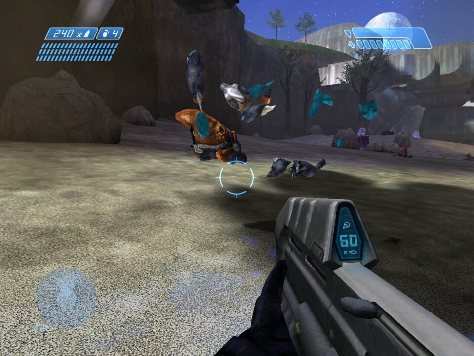
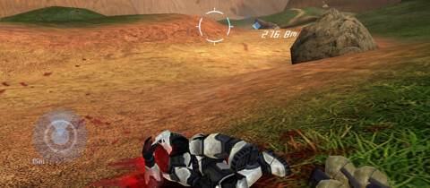
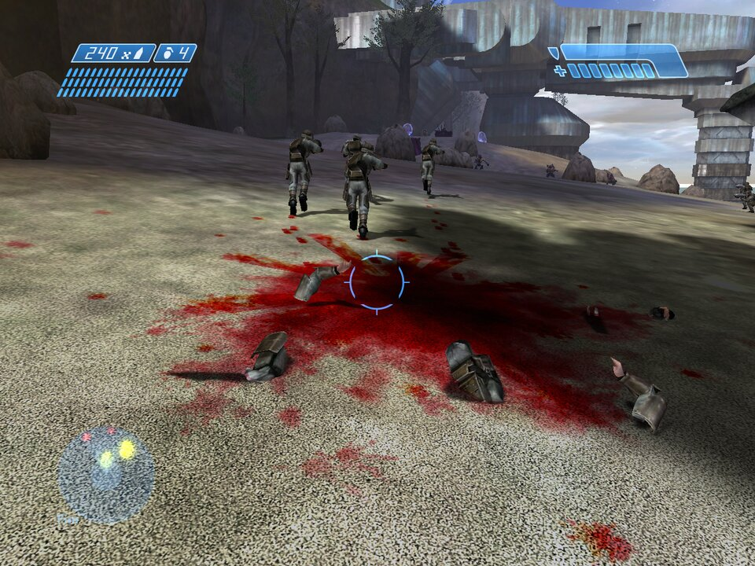
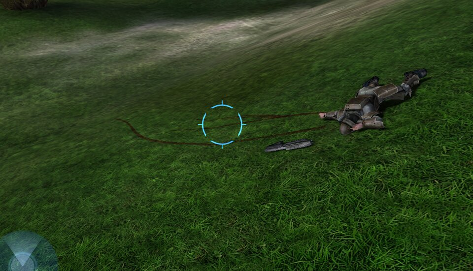
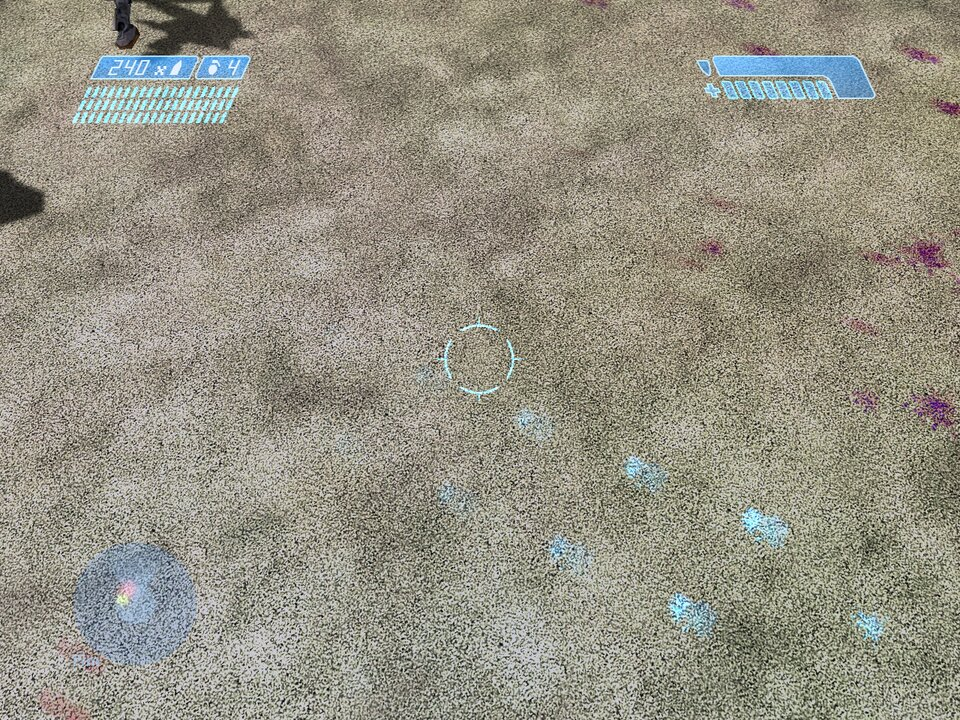
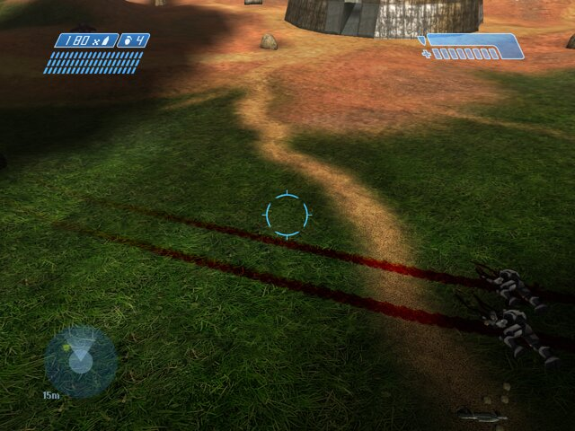
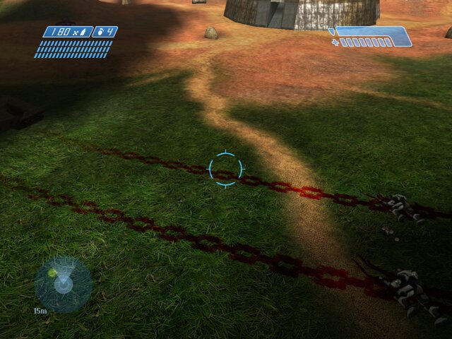
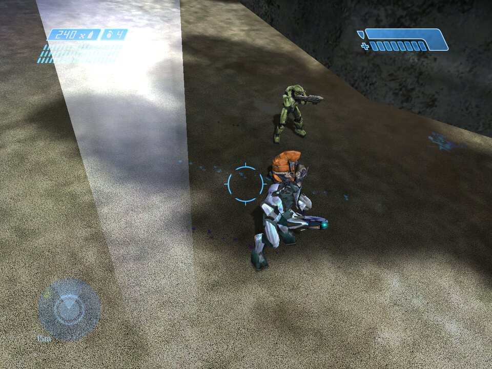
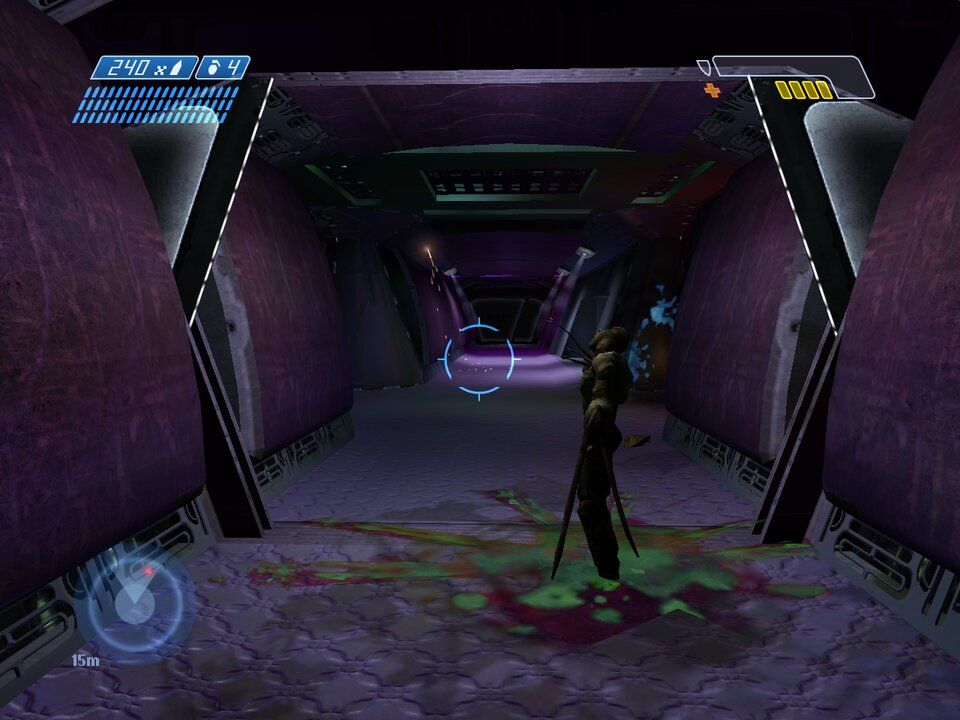
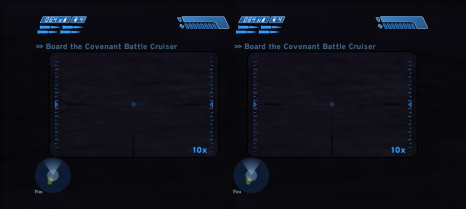

# Halo CE Gore Mod

A gore mod for Halo: Combat Evolved, for **Windows PC** and **Android**.
Enemies come apart — this is the build where a close explosion, a fast
vehicle hit or a point-blank shotgun doesn't just drop them.

Built on the OpenCE decompiled Halo CE engine (Xbox build). This repo is
builds only: grab a build from **Releases**, bring your own game files,
play.

## Downloads

Go to [Releases](../../releases) and download:

| File | Platform |
| --- | --- |
| `HaloCE-Gore-PC-Windows.zip` | Windows PC |
| `HaloCE-Gore-SBS-Android.apk` | Android (arm64, Android 9+) — also has SBS 3D stereo |

**No game data is included.** You need your own Halo: Combat Evolved
**Xbox disc image** (`.xiso` or `.iso`). On first start each build asks
for it and extracts the `maps/` folder itself (PC: next to the exe;
Android: into the app's data folder). Nothing copyrighted is distributed
here.

## What the mod does

On by default. All the settings are at **Settings → Player Setup →
(your profile) → Video Setup → EXTRA EFFECTS** (saved, apply straight
away):

| Setting | Options |
| --- | --- |
| **GORE** | Off / Mild / Heavy (default) / Extreme |
| **GORE DURATION** | Normal / Long / Very Long / Permanent: how long blood, pieces and bodies stay (multiplayer is capped at Long) |
| **CORPSE BLEED** | On / Off: corpse blood pools and trails |
| **MANUAL RESPAWN** | On / Off (campaign only): stay down when you die while the game keeps going, orbit the death camera to look around, and press to respawn when you're ready |

- Enemies killed by a close explosion or a fast vehicle hit come apart
  into six pieces (head, arms, legs, torso), with blood bursts, drips
  and ground splats. Pieces land, bounce, rest, then fade.
    *A Grunt gibbed at Extreme*
- Point-blank shotgun kills gib (within about 2 metres).
- A killing sniper-rifle headshot pops the head, with blood spurting
  from the neck. It also works when you join any server, because it is
  a local effect only.
    *Sniper headshot head pop*
- Hunters gib **only** to a direct Scorpion tank shell hit.
- **Impact splats:** a body that slams into the ground or a wall at very
  high speed (a huge fall, or flung by a blast) comes apart where it hits
  and leaves a big splat of blood. The pieces stay around the splat.
    *Impact splat*
- **Corpse blood trails:** bodies at rest pool blood that runs downhill in
  branching trails, in the character's blood colour (humans red, Grunts
  and Jackals cyan-blue, Elites blue-purple, Hunters orange).
    *Corpse blood trail running downhill*
- **Bloody footprints:** anyone who walks through blood leaves
  species-shaped footprints in that blood's colour, fading out over the
  next steps.
    *Bloody footprints in each species' blood colour*
- **Bloody vehicle tracks:** a Warthog or other wheeled vehicle, or a
  Scorpion, that runs over bodies or through blood leaves tracks in that
  blood's colour — the Warthog's own tyre print, or the Scorpion's tread
  plates — fading out over the distance it drives.
     *Warthog tyre tracks and Scorpion tread tracks*
- **Wound blood drips (campaign):** wounded characters drip blood in
  their own blood colour, leaving a trail of small drops as they move.
  On with the gore level at Heavy or Extreme.
    *Wound blood drips trailing behind wounded characters*
- **Flood gore:** the Flood have gore too, with their own blood colour,
  bursts and pools.
    *Flood gore*
- Works on enemies and on the player character.
- **Multiplayer (co-op and online/system link):** gore is on there too.
  Every player gibs the same kills on their own screen — the pieces are
  local eye-candy per machine and are never networked, so gore and
  non-gore players can play in the same game and nothing can desync.
  Online play requires all players on this version.

## Also from OpenCE

Each build includes the latest OpenCE engine features, including:

- New OpenCE gametypes: SWAT, Infection, Gun Game and Hardcore, in their
  own **OPENCE** bank of Select Gametype, with an **OPENCE OPTIONS**
  screen in the gametype editor.
- The server browser shows each game's gametype name, and opens on
  **ALL GAMES**: dedicated servers first, then games players host.
- Dedicated servers (PC): `halo.exe --server` runs a dedicated server
  with a web admin page and remote console, listed on the official
  master server.
- Shield effects are the host's choice in network games, or the host can
  leave them to each player.
- Co-op **ALLY FRIENDLY FIRE** option (Server Setup → Co-op Options):
  turn it off and your AI allies are immune to the players' fire.
- Co-op and Custom Edition improvements, and Android texture support for
  more GPUs.
- PC shader cache: effects stop stuttering the first time they appear.
- Smoother scope ticks, weapon lights and markers, and smoother movement
  of vehicles no one is driving (Pelicans, lifepods).

## PC install

1. Unzip `HaloCE-Gore-PC-Windows.zip` anywhere.
2. Run `halo.exe` (keep `SDL3.dll` next to it). Standalone program — it
   is not a mod for retail Halo CE/MCC and replaces nothing.
3. First start: select your Xbox disc image when asked. After that,
   just run `halo.exe`.

Needs OpenGL 4.5 graphics. Full details are in `README-INSTALL.txt`
inside the zip; advanced gore options are in `config.toml` next to the
exe (created on first run). Note: this build can check for updated
engine builds at start-up — an updated vanilla build will not have the
gore, so keep this folder if you want it.

## Android install

1. Copy your Xbox disc image (`.xiso` or `.iso`) onto the phone.
2. Install `HaloCE-Gore-SBS-Android.apk` (sideload; 64-bit devices,
   Android 9 or later).
3. Start it and select the disc image when asked.

Touch controls and controllers both work, and gyro aim works alongside
a controller. Touch button opacity can go all the way to invisible.

**SBS 3D (Android):** side-by-side stereoscopic 3D for cardboard
viewers / SBS displays — Settings → Player Setup → (profile) →
Video Setup → **STEREO 3D (SBS)**, with **EYE DISTANCE** to match your
viewer (64 mm is average). Stereo turns itself off in local
split-screen (it needs one fullscreen view); in online/co-op play
everyone is fullscreen, so stereo and multiplayer gore work together.

 *SBS 3D: the sniper scope at 10x in both eyes*

## Credits

Built on the OpenCE decompiled engine. Engine licence files are
included in each download; this repo's own licence is in `LICENSE.md`.

Found a gore bug? Open an issue with the platform (PC/Android), the
weapon/enemy involved, and whether it was single player or multiplayer.
